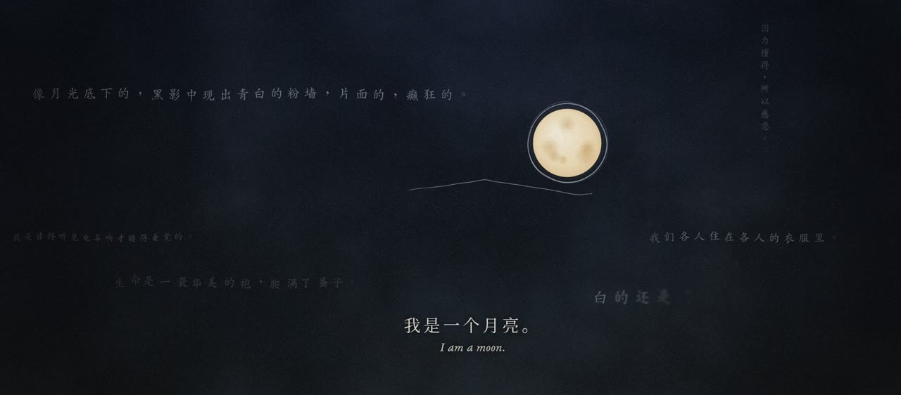
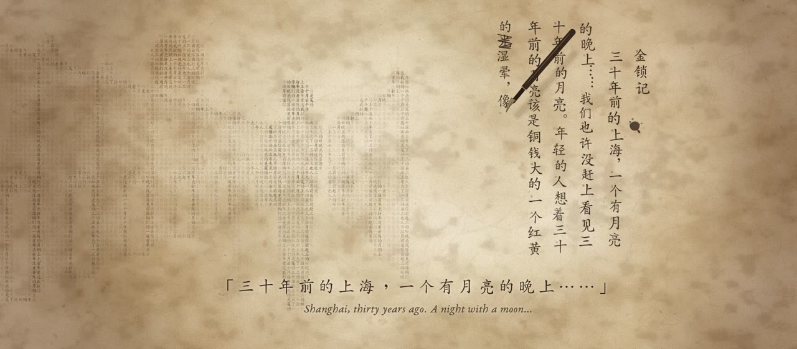
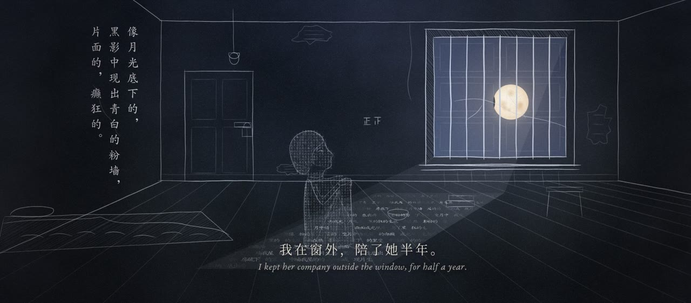
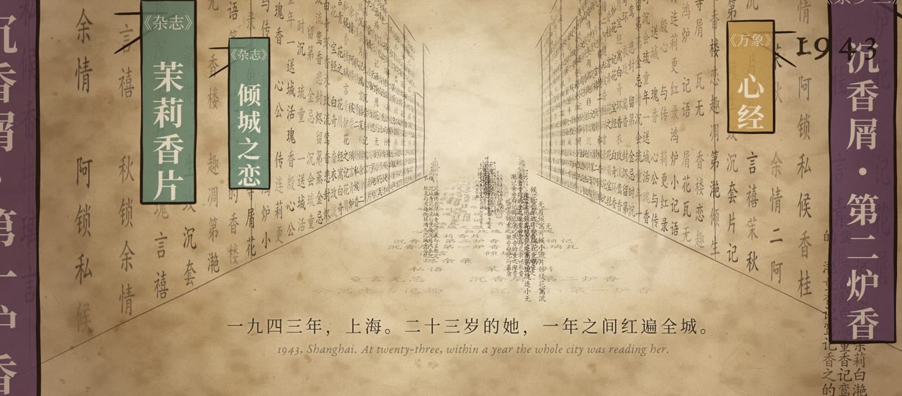
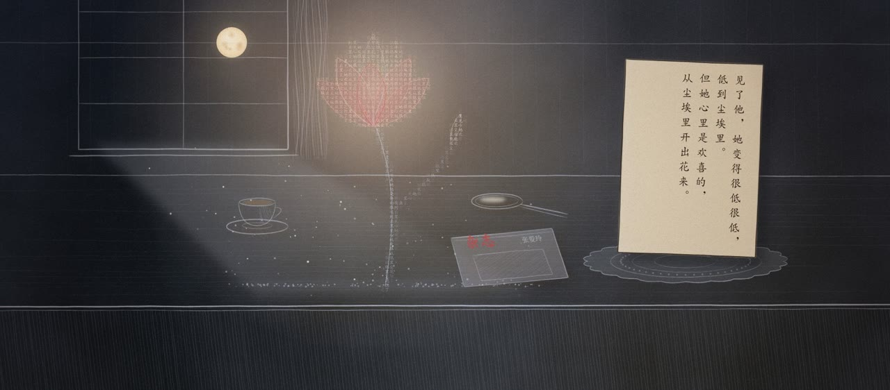
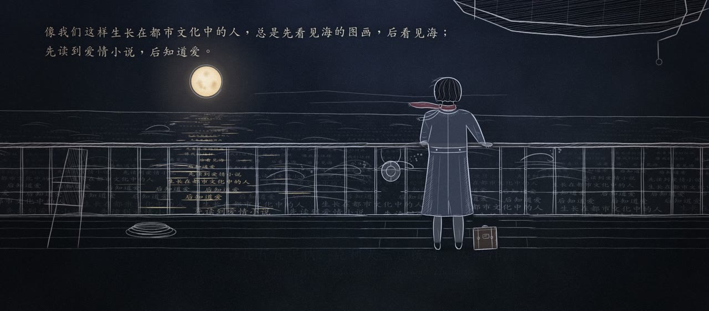
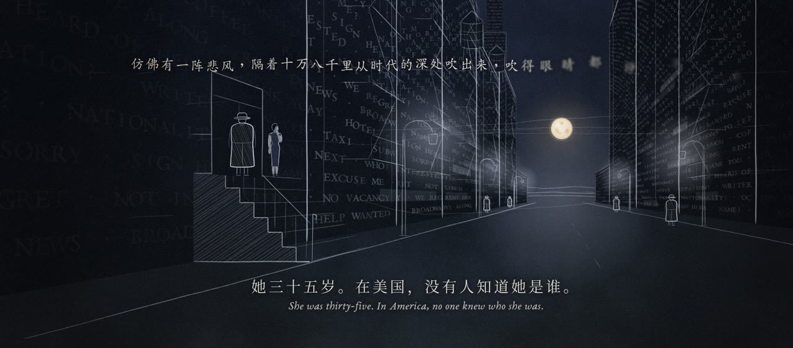
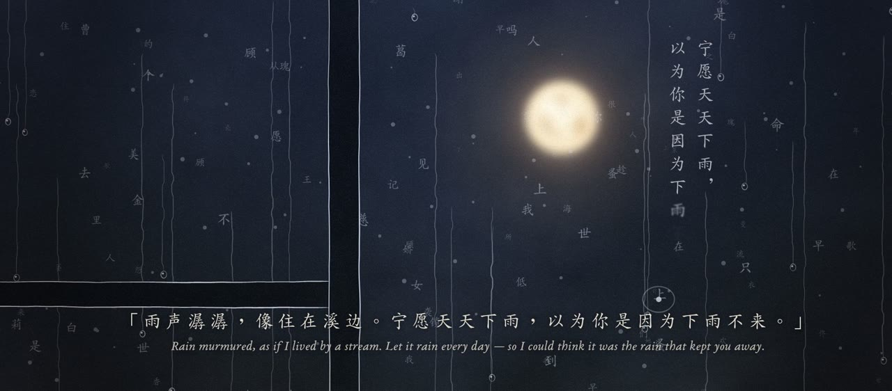

# 一个有月亮的晚上 · A Night with a Moon

> 三十年前的上海，一个有月亮的晚上——她一生都在写月亮。今晚，换月亮来写她。

一部用代码逐笔「手绘」的张爱玲（1920–1995）传记短片，时长 4:45，卡点赵雷《程艾影》。
**0 台摄影机 · 0 张 AI 生图 · 14,510 行代码。** 编剧、分镜、绘制、渲染：Claude Opus 5.5（1 个导演 agent + 8 个并行子 agent）。


| | | |
|---|---|---|
|  |  |  |
|  |  |  |
|  |  |  |
|  |  |  |

全片每 5 秒一帧的总览：[docs/img/contact_sheet.jpg](docs/img/contact_sheet.jpg)

---

## 这是什么

这个仓库包含三部分：
1. **影片的全部源代码**：Remotion + Canvas 2D 的程序化绘画引擎、7 个段落的场景、张爱玲人物库、旁白与事实核对表。
2. **多 agent + skills 工作流**（`.claude/`）：用 Claude Code 复现「一个导演 agent 统筹多个绘制 agent」的制作方式。
3. **完整制作记录**（[docs/WORKFLOW.md](docs/WORKFLOW.md)）：从需求、两轮用户反馈到 B站 交付，以及踩过的坑。

## 多 agent 与 skills

```
.claude/
├── agents/                 谁来做
│   ├── film-director.md    导演：概念、旁白、引擎、派活、审片、转述用户反馈
│   ├── scene-artist.md     段落画师（×6）：每人一个 segX.ts
│   ├── figure-artist.md    人物画师（×2）：同一个张爱玲，10 个姿态，含黑白相纸与文字蒙版模式
│   ├── art-reviewer.md     新上下文美术审片：按清单给出必改项
│   ├── fact-checker.md     事实与引文逐字核对（「华美」不是「华丽」）
│   └── render-engineer.md  分段渲染、混音、响度、编码、B站交付
└── skills/                 怎么做
    ├── biopic-film/        总流程与各阶段闸门
    ├── song-analysis/      节拍、能量曲线、歌词时间轴
    ├── narration-script/   叙事者、旁白卡点、引文规则
    ├── pen-engine/         手绘笔触引擎速查
    ├── text-matter/        「文字成像」
    ├── stills-review/      画 → 看 → 改 的循环
    ├── render-and-master/  渲染与母版（含全部踩坑）
    └── bilibili-publish/   封面、字幕、标题、简介、声明
```

在 Claude Code 里打开本仓库，对它说「用 film-director 做一部 X 的手绘传记片，参考片是…，音乐是…」，导演 agent 会按 `biopic-film` 的流程派出各个子 agent。

## 快速开始

```bash
npm install                          # Remotion 4、React 19
# 字体（系统字体）：Noto Serif CJK SC、AR PL UKai CN、EB Garamond
# 音乐不随仓库分发：把你自己合法获得的《程艾影》放到 public/audio/song.wav
python3 work/beats.py                # 生成节拍网格（仓库里已附带 src/data/beats.json）
node tools/stills.mjs --tag try --sheet 8 21.5 102.6 244.4   # 截几张静帧看看
tools/render_all.sh                  # 1080P 分段渲染 → out/film_video.mp4
node tools/dump_sfx.mjs && python3 work/sfx.py work/writing_sfx.json public/audio/song.wav public/audio/song_sfx.wav
tools/master.sh out/film_video.mp4 output/film.mp4
```
需要 Chrome（`/usr/bin/google-chrome`）、ffmpeg、Python 3（librosa、soundfile、scipy；识别歌词还需要 whisper）。

## 目录

```
src/lib/        pen.ts 笔触 · ground.ts 纸/夜/月 · type.ts 字幕与竖排 · textmatter.ts 文字成像
                film.ts 合成器与转场 · eileen*.ts 人物库 · texture.ts 噪声与纸纹 · math.ts 节拍工具
src/scenes/     segA … segG（0:00–4:45 的 7 段）
src/data/       script.ts 旁白 · lyrics.ts 歌词时间轴（不含歌词原文）· beats.json · credits.ts
src/lab/        人物实验台、文字成像实验台、封面
tools/          stills.mjs 静帧 · render.mjs / render_all.sh 渲染 · master.sh 母版 · dump_sfx.mjs · showcase.py
work/           beats.py · asr.py · sfx.py（钢笔声合成）· make_srt.py（CC 字幕）
BRIEF.md        给所有 agent 的团队说明      SCRIPT.md  引文与事实出处
```

## 版权与许可

- 代码采用 MIT 许可，见 [LICENSE](LICENSE)。
- **音乐和歌词不包含在本仓库中。** 赵雷《程艾影》的版权归原作者及版权方所有，仓库里只保留节拍与歌词的时间戳。
- 片中引用的张爱玲、胡兰成文字为短篇幅引用，版权归原作者及权利人所有，出处逐条列在 [SCRIPT.md](SCRIPT.md)。
- 1954 年那张经典照是按记忆手绘重构的插画，不是原照片。
- 详见 [NOTICE.md](NOTICE.md)。本项目仅供非商业学习与交流。
